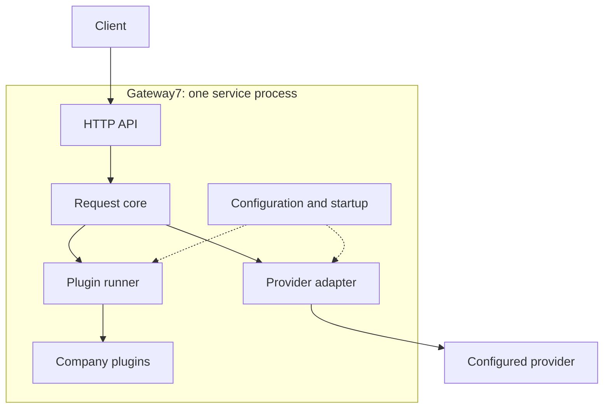
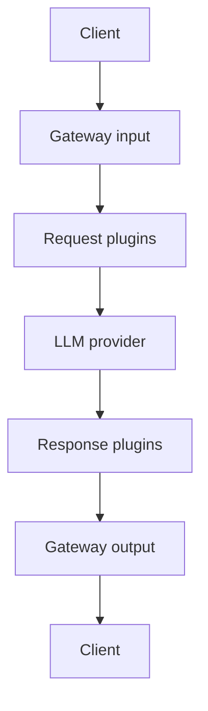

# Gateway7 architecture proposal

**Status:** Proposed for review, 2026-10-15; this document does not establish implementation or Customer acceptance.

Gateway7 is one service: the core orchestrates company plugins and a single configured provider adapter.
The [product vision](../product-vision.md), [DEC-009](../decisions.md#dec-009)–[DEC-012](../decisions.md#dec-012) require a demonstrable plugin boundary, permit restart-based installation and a deterministic first demo, and retain US-01–03 as the candidate.
Python was selected on 15 October; [implementation PR #53](https://github.com/iteam7/gateway7/pull/53) records DEC-013 and the runnable prototype.
This proposal keeps the contracts language-neutral and changes no story criteria.

## Components and dependencies

| Component | Responsibility |
| --- | --- |
| HTTP API | Validate input, create context, serialize allowed results and safe errors |
| Request core | Sequence request hooks, one provider call, response hooks and cleanup through interfaces |
| Plugin runner | Invoke ordered hooks, validate results and check deadlines; no company policy |
| Company plugins | Allow, modify or deny content through the shared contract |
| Provider adapter | Translate normalized data, attach the server key and normalize responses/errors |
| Configuration and startup | Load trusted modules, validate settings and construct chains and adapter |

One process avoids separate plugin services and a database, but shares resources and failures.
Plugins depend on the contract rather than HTTP handlers or provider SDKs; adding a plugin changes its module and configuration, not the core.

## Customer view

The seven stages below are the request lifecycle; gateway input, plugins and output belong to the same service.

## Request lifecycle

1. Assign a request ID and validate the text-chat format and size before plugins or forwarding. Reject unsupported fields; create a deadline and isolated plugin state for valid input.
2. Run the request chain. Each hook sees its predecessor's output. `Continue` advances; `Deny` returns a policy error. Exceptions, invalid results and timeouts fail closed with a technical error and **zero upstream calls**.
3. Recheck cancellation/deadline, then call the configured provider once with the processed request and server key. Adaptation, upstream or normalization failures return technical errors without response hooks.
4. Run the independent response chain only after upstream success. A denial blocks delivery but cannot undo provider work or usage.
5. Return the allowed response or safe error with its request ID while connected. Record a safe outcome and release request-owned state on every exit, including disconnect, once in-flight work unwinds.

Capture validated provider usage before response hooks; plugins must not overwrite that observation.
Absent/invalid usage and failed/cancelled calls mean **unknown, not zero**; this is request metadata, not billing or a durable ledger.

## Data and plugin contract

| Contract | Contents |
| --- | --- |
| Request | Ordered messages with supported roles and plain text, including history; validated generation options. Provider selection is server configuration. |
| Response | Assistant text and normalized metadata, including provider usage when known; no credentials or raw upstream errors. |
| Context | Core-owned request ID, start time, deadline/cancellation and temporary state namespaced per plugin. |
| Result | `Continue(processed_payload, safe_metadata)` or `Deny(reason_code, safe_message)`; unchanged payload allows, modified payload transforms. Technical failures are not policy denials. |

Hooks are `on_request(request, context)` and `on_response(response, context)`.
Their configured lists are independent: response order is never implicitly reversed; an empty list passes through.
Each listed hook runs once, sequentially; reject duplicate IDs, unknown references and missing configured hooks at startup.
Loaded instances may serve concurrent requests: keep configuration immutable/resources concurrency-safe and mutable request state in the context.
A later trusted plugin can change earlier output, so verify the whole chain on fixtures.

## Loading, trust and limits

Install trusted modules, configure their IDs/settings/order, then restart ([DEC-010](../decisions.md#dec-010)).
Validate contract versions, hooks, settings, initialization and credentials before readiness; missing modules/keys or invalid chains abort startup safely, never silently skip filters.
Initially every configured hook is required; the proposal has no fail-open mode.
Only the adapter receives the server-configured key through the ordinary interfaces ([CON-04](../product-vision.md#con-04)); callers cannot select modules or upstream URLs.
**In-process plugins are not sandboxed:** installed code can access memory, environment, files and network, so operators must trust it.

Check cancellation/deadlines before stages and after hooks; stop later stages, signal cooperative cancellation and discard late results.
Blocking/uncooperative plugins cannot be forcibly stopped and can delay responsiveness or cleanup; cancelling a provider call does not prove it stopped upstream.
Logs contain only request ID, outcome, safe component/reason codes and durations, excluding content, keys, headers, plugin state and raw errors; fixture capture is synthetic-only.
No original-text restoration/storage, hot loading, streaming, retries/failover, persistent conversations, billing or user-supplied keys; discarding state does not promise secure memory erasure.

## Traceability and first implementation slice

| Source | Required demonstration |
| --- | --- |
| [US-01](https://github.com/iteam7/gateway7/issues/30), AC-01–04; CON-04 | HTTP fake-upstream answer/key forwarding, missing-key startup failure and no key in client output/logs |
| US-01, AC-05; [DEC-011](../decisions.md#dec-011) | Actual Claude/Gemini `pong`; deterministic checks do not satisfy this criterion |
| [US-02](https://github.com/iteam7/gateway7/issues/31), AC-01–03; [VP-01](../research/value-proposition.md#vp-01-predictable-local-preflight-for-small-teams) | Three specified phone formats become `[PHONE]`, including history; benign order/date fixture stays unchanged |
| [US-03](https://github.com/iteam7/gateway7/issues/32), AC-01–03; [VP-02](../research/value-proposition.md#vp-02-testable-domain-filter-extensions); DEC-009–010 | Sample plugin installed by module/config only, restart, missing-module failure and A-then-B order |

Check fail-closed exits, invalid results, isolated state and safe logs alongside these fixtures.
US-03 covers request plugins; response hooks establish no production output policy or separate story acceptance.
Authentication, routing and durable usage accounting remain extension points, outside this slice.

## Review questions and Week 2 follow-up

This prepares the architecture presentation; presentation and Customer evaluation remain pending.
Review the hook/loading/error contract, phone formats, deployment secret source and capacity; two plugins are a demonstration, not a limit.
The Python implementation and its concrete API/limits are tracked in PR #53; its evidence and Customer verdicts remain separate from this proposal.
