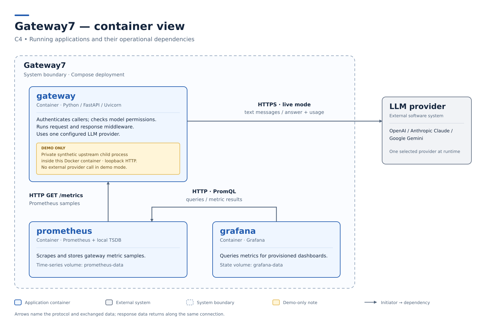

# Gateway7 architecture

This architecture serves the scope in the [product vision](../product-vision.md).

## Drivers

- **Business goals:** the [threshold of success](../threshold-of-success.md) holds the outcomes the architecture serves.
- **Constraints:** the product vision's [constraints](../product-vision.md#constraints) hold the conditions the architecture lives inside.
- **Functional requirements:** the requirements index at `docs/functional-requirements/README.md` is pending [task #91](https://github.com/iteam7/gateway7/issues/91); no requirement identifiers are assigned here.
- **Quality requirements:** the priority matrix at `docs/quality-requirements/README.md` is pending [task #91](https://github.com/iteam7/gateway7/issues/91); no quality targets or achieved thresholds are inferred from the implementation.

## Container View

The deployed applications below and their stack are documented in [ADR-001](adr/ADR-001.md), whose requirement links and acceptance remain pending.



The [Compose definition](https://github.com/iteam7/gateway7/blob/main/compose.yaml) starts `gateway`, `prometheus` and `grafana` together.
The gateway can also run alone through the CLI; the monitoring applications are deployment companions, not separate policy services or an extra hop in the chat path.
Container here means a running application or data store, rather than a Python module.
The only production containers in this view are the three named rows below; their files and volumes belong to those applications rather than separate database services.

The external LLM is one provider selected at startup: OpenAI, Claude or Gemini.
It receives allowed messages over HTTPS using the server's credential; gateway callers cannot select another provider or origin, and the gateway does not retry or fail over a forwarded request.
The [live override](https://github.com/iteam7/gateway7/blob/main/compose.live.yaml) starts `serve` with that provider configuration.
The default Compose command instead runs `demo`: it starts a synthetic HTTP upstream as a child process on loopback inside the gateway's Docker container and contacts no real LLM.
The amber fixture annotation is this development-only variant, not a fourth production container or fallback provider.

### Container Responsibilities

| Container | Responsibilities |
| --- | --- |
| `gateway` | Authenticates callers and enforces model permissions; applies request and response policies and invokes the configured provider; owns startup configuration, credential handles, temporary request state and in-memory observations |
| `prometheus` | Collects numeric gateway observations; retains time-series samples in its own data volume; serves queries over those samples |
| `grafana` | Queries operational time series; renders provisioned dashboards; owns application runtime state in its own data volume |

`gateway` stores no durable conversation or original-text restoration map.
Its trusted plugins share the process, so this describes the core's behavior rather than a sandbox guarantee about installed code.
`prometheus` uses `prometheus-data`, with the configured seven-day and 512 MB retention bounds; `grafana` uses `grafana-data` and reads provisioned dashboard/data-source files from the repository.
These are operational observations and display state, not a billing ledger.
The missing functional requirements must cover behavior in all three containers before the table can claim the complete course trace from behavior to deployment.

### Runtime boundaries

The [HTTP contract](../api.md) exposes native `POST /chat`, a nonstreaming text subset at `POST /v1/chat/completions`, and filtered `GET /v1/models` discovery.
[Authentication](../authentication.md) runs before protected-body processing; model permission is checked before company middleware or provider invocation.
Both chat routes enter the same pipeline, which receives the authorized model separately from plugin-visible text.
This protects the documented plugin interface from model changes; it does not isolate hostile Python code from the process.

[ADR-002](adr/ADR-002.md) describes trusted middleware: one configured request order, reverse response unwinding, terminal failures and at most one gateway-owned provider invocation.
A request-side denial makes zero provider calls; a response-side denial can block delivery after one call has already happened.
Provider usage and finish reason are preserved independently of response text changes, and missing usage stays unknown.
Cooperative cancellation discards late results but cannot forcibly stop blocking plugin code or undo work already accepted upstream.
The [plugin guide](../plugins.md) carries the exact handler, lifecycle and diagnostic contract; the [authoring guide](../authoring.md) covers generated packages and the offline worker's limited Python-level networking guards.

[ADR-003](adr/ADR-003.md) describes separate caller and provider credentials and request-local model authorization.
Real-provider configurations require gateway authentication; synthetic fixture configurations may disable it explicitly.
The gateway's own diagnostic events and metric labels omit text and credentials, but trusted installed modules can access the process environment and produce their own output.
`/health`, `/ready` and `/metrics` remain unauthenticated operational endpoints; readiness checks initialization without making a paid provider call.
The shipped ports bind to localhost, and shared deployments require their own HTTPS termination and restricted operational network boundary.
See [observability](../observability.md) for the dashboard, metric semantics and limitations.

### Customer view

Use the container image above to explain the running system, then follow the [existing demonstration](../demo.md) through request policies, one provider call and response policies.
The [approved and merged implementation PR](https://github.com/iteam7/gateway7/pull/90) is evidence of the implemented choices and their automated checks, not proof of a keyed live-provider call or completion of the separately required Windows verification in [task #84](https://github.com/iteam7/gateway7/issues/84).

### Review questions and Week 2 follow-up

The composition and execution questions in [DEC-014](../decisions.md#dec-014) and [DEC-015](../decisions.md#dec-015) remain review topics: show how an operator locates a failing or hanging plugin and follows its timing, and demonstrate three interacting plugins with their authoring/configuration workflow.
The Customer's Django and Twisted examples did not mandate either framework; [ADR-002](adr/ADR-002.md) makes the selected execution model and its limits explicit.
Production phone-format coverage and the deployment secret source remain open validation questions.
This document does not record a new meeting, capacity result or Customer acceptance.

#### Team clarification — 19 October 2026

On 19 October, azamatbayramov reported on behalf of the team that US-01–03 had been demonstrated with positive Customer feedback, while technical questions called for further architecture work.
That date records the presenter's clarification, not a new meeting or a confirmed feedback date; AC-by-AC acceptance and real-provider US-01 AC-05 were not established.
The clarification supplied no owners or deadlines for the follow-up and confirmed no separate recording/transcript-publication permissions.

## Diagrams And Legends

The container image is generated from the adjacent [source](container.py) using Python's standard library:

```sh
python docs/architecture/container.py
```

The source fixes the node labels, relationships, legend and layout; regenerate and commit the source/image pair together.
The blue application cards are product containers, the grey card is the external provider, and the dashed frame encloses the deployed product.
The amber note marks the synthetic demo variant within `gateway`; it is not an independent production container.
Directed arrows point from the initiator to the service it calls; their labels name both the protocol and exchanged data, including replies.
No external actors appear in this view; the product vision retains their [system context](../product-vision.md#context) and its existing image/source pair.

## Architectural Decisions

| ADR | Status | Addresses | Decision |
| --- | --- | --- | --- |
| [ADR-001](adr/ADR-001.md) | Proposed | Pending [#91](https://github.com/iteam7/gateway7/issues/91): gateway execution, operational monitoring and testability requirements | Keep one Python gateway with separately deployed monitoring applications |
| [ADR-002](adr/ADR-002.md) | Proposed | Pending [#91](https://github.com/iteam7/gateway7/issues/91): middleware composition, denial, failure and offline-test requirements | Run trusted plugins as guarded middleware inside the gateway |
| [ADR-003](adr/ADR-003.md) | Proposed | Pending [#91](https://github.com/iteam7/gateway7/issues/91): client/model authorization, provider credentials and confidentiality requirements | Authorize clients separately and pin permitted models outside plugin payloads |

These records document the implementation already merged in PR #90 and its recorded human review.
They are dated when written, not when an undocumented earlier discussion might have happened.
They remain Proposed because the required FR/QR records do not exist and the ADR-to-requirement mapping has not been reviewed.
Each record identifies the exact missing behavior and quality scenario; none invents a requirement identifier or an additional Customer decision.
After #91 merges, replace the two pending Drivers entries with the real index links, link each ADR's Addresses and quality consequences to the resulting records, update this index, and have the Accountable reviewer confirm the records before marking them Accepted.
The [ADR template](adr/TEMPLATE.md) provides the unfilled shape for later decisions.
