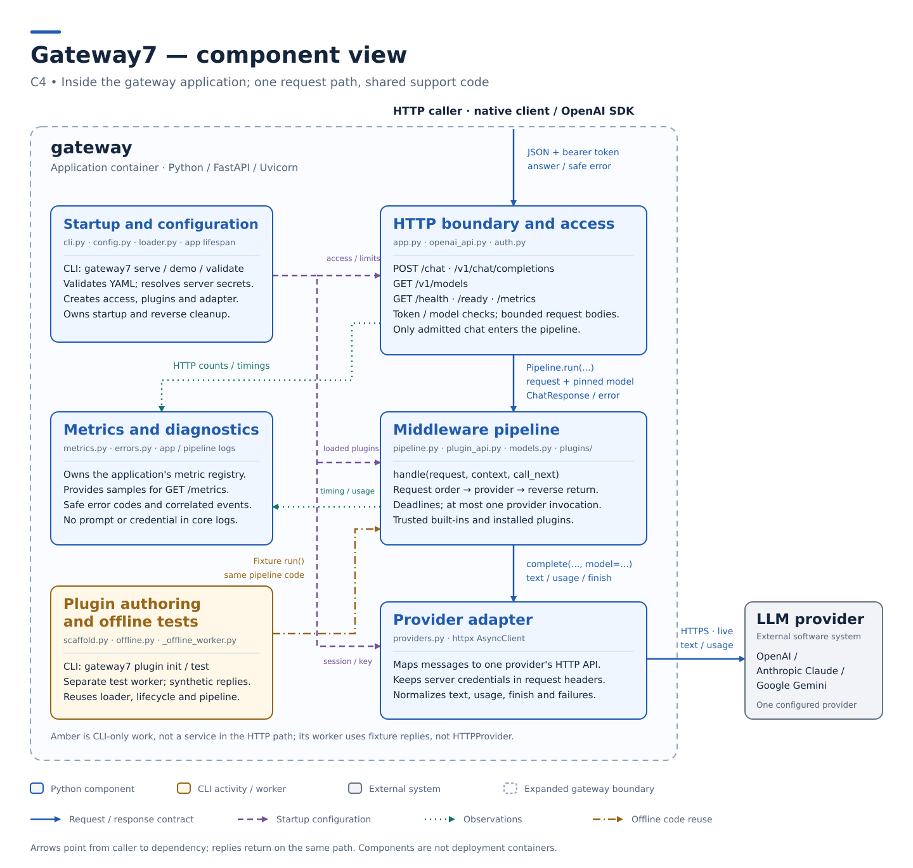
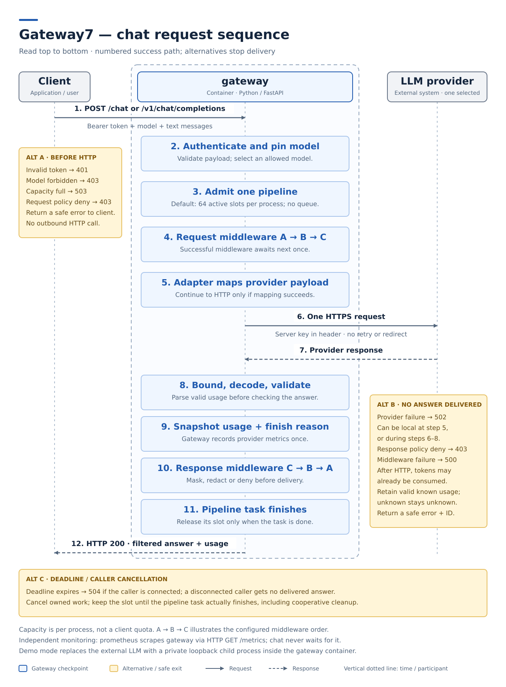

# Gateway7 architecture

This architecture serves the scope in the [product vision](../product-vision.md).

**Read in five minutes:** [what runs](#container-view) · [components and code](#component-view) · [one request](#sequence-view) · [startup and shutdown](#startup-and-shutdown).
For a working first request, use the [quickstart](../quickstart.md).

## Drivers

- **Business goals:** the [threshold of success](../threshold-of-success.md) holds the outcomes the architecture serves.
- **Constraints:** the product vision's [constraints](../product-vision.md#constraints) hold the conditions the architecture lives inside.
- **Functional requirements:** the [functional requirements index](../functional-requirements/README.md) holds the behavior the architecture must deliver.
- **Quality requirements:** the [quality requirements index](../quality-requirements/README.md) holds the quality the architecture must meet and its priority matrix.

## Container View

The product runs as the containers below, and [ADR-001](adr/ADR-001.md) records their split and stack.


[Open the full-size container image](container.svg) · [Image source](container.py)

The [Compose definition](https://github.com/iteam7/gateway7/blob/8cdf230c77e029074d0b3b9ad82e3edc6d25b59b/compose.yaml) starts `gateway`, `prometheus` and `grafana` together.
Only `gateway` is on the chat path; the monitoring applications collect and display observations separately.
A container here is a running application or data store, not a Python module.
The gateway can also run alone through its CLI.

One external LLM provider is selected at startup: OpenAI, Claude or Gemini.
The [live override](https://github.com/iteam7/gateway7/blob/8cdf230c77e029074d0b3b9ad82e3edc6d25b59b/compose.live.yaml) calls it over HTTPS with the server's key.
An optional [provider transport](../provider-transports.md) can tunnel that HTTPS connection through an operator's proxy.
The proxy is external network infrastructure; the shipped Compose stack does not add or manage a proxy container.
The default Compose command runs `demo` instead: a private synthetic HTTP upstream runs as a child process **inside the gateway's Docker container**.
It replaces the external call for this demo; it is neither a fourth deployment container nor a fallback provider.

### Container Responsibilities

| Container | Responsibilities |
| --- | --- |
| `gateway` | Authenticates callers and checks model permissions; runs company middleware and invokes the configured provider; owns startup settings, credentials, temporary request state and in-memory observations |
| `prometheus` | Collects numeric gateway observations; retains time-series samples in its own data volume; serves queries over those samples |
| `grafana` | Queries operational time series; renders provisioned dashboards; owns application runtime state in its own data volume |

The gateway core keeps no durable chat history or original-text restoration map.
Request context, active-pipeline counts and metric counters live in memory; process restart resets them.
Plugins share that process and are responsible for any state they choose to keep.
Prometheus retains numeric samples in `prometheus-data`, bounded by seven days and 512 MB; Grafana keeps its state in `grafana-data` and reads the provisioned dashboard and datasource files.
These volumes survive `docker compose down`; `--volumes` removes them.
This is monitoring history, not a billing ledger.

The existing requirements assign gateway behavior to `gateway` in [FR-001](../functional-requirements/fr/FR-001.md) and [FR-009](../functional-requirements/fr/FR-009.md), and monitoring behavior to `prometheus` and `grafana` in [FR-010](../functional-requirements/fr/FR-010.md).

## Component View

This view opens the `gateway` application from the container view.
The boxes group code by responsibility; they are **not separately deployed services**.
CLI authoring and its offline worker are separate activities from serving a chat request.



[Open the full-size component image](component.svg) · [Image source](component.py)

### Code map

Start with the HTTP boundary, follow the pipeline into the provider adapter, then inspect the policy or lifecycle code you want to change.
The source links below describe the implementation at [main commit 8cdf230c](https://github.com/iteam7/gateway7/commit/8cdf230c77e029074d0b3b9ad82e3edc6d25b59b).

| Component | Responsibility and interface | Start reading |
| --- | --- | --- |
| Startup and configuration | `gateway7` / `python -m gateway7` select a command; configuration and the app lifespan load and start the configured instances | [cli.py](https://github.com/iteam7/gateway7/blob/8cdf230c77e029074d0b3b9ad82e3edc6d25b59b/gateway7/cli.py#L326), [config.py](https://github.com/iteam7/gateway7/blob/8cdf230c77e029074d0b3b9ad82e3edc6d25b59b/gateway7/config.py#L137), [loader.py](https://github.com/iteam7/gateway7/blob/8cdf230c77e029074d0b3b9ad82e3edc6d25b59b/gateway7/loader.py#L55), [app lifespan](https://github.com/iteam7/gateway7/blob/8cdf230c77e029074d0b3b9ad82e3edc6d25b59b/gateway7/app.py#L280) |
| HTTP boundary and access | FastAPI serves `/chat`, `/v1/chat/completions`, `/v1/models` and operational endpoints; checks token, body, model and available capacity | [app.py](https://github.com/iteam7/gateway7/blob/8cdf230c77e029074d0b3b9ad82e3edc6d25b59b/gateway7/app.py#L54), [auth.py](https://github.com/iteam7/gateway7/blob/8cdf230c77e029074d0b3b9ad82e3edc6d25b59b/gateway7/auth.py#L27), [openai_api.py](https://github.com/iteam7/gateway7/blob/8cdf230c77e029074d0b3b9ad82e3edc6d25b59b/gateway7/openai_api.py#L33) |
| Middleware pipeline | `Pipeline.run` nests trusted `handle(request, context, call_next)` handlers; validates neutral payloads and enforces forwarding and time limits | [pipeline.py](https://github.com/iteam7/gateway7/blob/8cdf230c77e029074d0b3b9ad82e3edc6d25b59b/gateway7/pipeline.py#L76), [plugin_api.py](https://github.com/iteam7/gateway7/blob/8cdf230c77e029074d0b3b9ad82e3edc6d25b59b/gateway7/plugin_api.py#L11), [models.py](https://github.com/iteam7/gateway7/blob/8cdf230c77e029074d0b3b9ad82e3edc6d25b59b/gateway7/models.py#L8), [reference plugins](https://github.com/iteam7/gateway7/tree/8cdf230c77e029074d0b3b9ad82e3edc6d25b59b/gateway7/plugins) |
| Provider adapter | `complete(request, model=...)` maps the request, sends HTTP to one configured origin and validates the answer and usage | [providers.py](https://github.com/iteam7/gateway7/blob/8cdf230c77e029074d0b3b9ad82e3edc6d25b59b/gateway7/providers.py#L218) |
| Metrics and diagnostics | Holds one metric registry per app; records safe outcomes, durations and usage; returns fixed public error messages | [metrics.py](https://github.com/iteam7/gateway7/blob/8cdf230c77e029074d0b3b9ad82e3edc6d25b59b/gateway7/metrics.py#L8), [errors.py](https://github.com/iteam7/gateway7/blob/8cdf230c77e029074d0b3b9ad82e3edc6d25b59b/gateway7/errors.py#L10) |
| Plugin authoring and offline tests | Generates a package; runs fixtures in a short-lived worker using the same loader and pipeline with an in-memory provider | [scaffold.py](https://github.com/iteam7/gateway7/blob/8cdf230c77e029074d0b3b9ad82e3edc6d25b59b/gateway7/scaffold.py#L159), [offline.py](https://github.com/iteam7/gateway7/blob/8cdf230c77e029074d0b3b9ad82e3edc6d25b59b/gateway7/offline.py#L156), [_offline_worker.py](https://github.com/iteam7/gateway7/blob/8cdf230c77e029074d0b3b9ad82e3edc6d25b59b/gateway7/_offline_worker.py#L74) |

The rest of the repository supports those components:

| Location | Use it for |
| --- | --- |
| [config/](https://github.com/iteam7/gateway7/tree/8cdf230c77e029074d0b3b9ad82e3edc6d25b59b/config) | Provider, client access, limits and middleware examples |
| [gateway7/demo.py](https://github.com/iteam7/gateway7/blob/8cdf230c77e029074d0b3b9ad82e3edc6d25b59b/gateway7/demo.py), [demo/](https://github.com/iteam7/gateway7/tree/8cdf230c77e029074d0b3b9ad82e3edc6d25b59b/demo), [examples/](https://github.com/iteam7/gateway7/tree/8cdf230c77e029074d0b3b9ad82e3edc6d25b59b/examples) | The packaged synthetic upstream, the separate recording walkthrough and sample plugins |
| [tests/](https://github.com/iteam7/gateway7/tree/8cdf230c77e029074d0b3b9ad82e3edc6d25b59b/tests), [scripts/](https://github.com/iteam7/gateway7/tree/8cdf230c77e029074d0b3b9ad82e3edc6d25b59b/scripts) | Regression tests and installed-wheel/Compose smoke checks |
| [Dockerfile](https://github.com/iteam7/gateway7/blob/8cdf230c77e029074d0b3b9ad82e3edc6d25b59b/Dockerfile), [compose.yaml](https://github.com/iteam7/gateway7/blob/8cdf230c77e029074d0b3b9ad82e3edc6d25b59b/compose.yaml), [monitoring/](https://github.com/iteam7/gateway7/tree/8cdf230c77e029074d0b3b9ad82e3edc6d25b59b/monitoring) | Image packaging, deployment and monitoring configuration |

To add a company policy, use the [generate → test → install workflow](../authoring.md).
The [middleware API](../plugins.md#descriptor-and-hooks) defines the contract; a new policy does not need a core edit.
Provider networking has a separate [startup transport interface](../provider-transports.md): `transport_api.py` defines its descriptor, `transport_loader.py` validates modules, and `transports/` holds the shipped proxy module.
It belongs to the provider adapter component, outside the per-request middleware chain.

### Startup and shutdown

`serve` loads strict YAML, resolves the provider key and client tokens from environment variables, checks plugin descriptors/settings, creates instances and the HTTP adapter, then awaits startup hooks.
If configured, a provider transport factory runs once before the adapter client is created.
Startup closes a valid transport if client construction fails; after construction, the client owns it and closes it with the provider during lifespan cleanup.
The built-in proxy keeps this shared client but uses request-owned connections so a cancelled TLS handshake cannot leave a tunnel occupying a shared pool slot; proxied requests do not reuse keep-alive connections.
The app becomes ready only after these local steps succeed.
The CLI owns this lifespan and the Uvicorn server; readiness does not make a provider request or prove account access.

`validate` checks configuration and loads trusted factories without requiring credentials or calling the provider.
It does not run startup hooks, and importing a plugin can have side effects.
For a provider transport, it checks only the descriptor and settings: it does not call the transport factory or resolve the proxy environment variable.
`plugin test` instead starts a limited worker with synthetic fixtures and Python-level networking guards; it is not an operating-system sandbox.
That fixture path does not load provider transports.

On shutdown, readiness becomes false, hooks are attempted in reverse instance order, and the provider client is closed even if a hook raises or cancels itself.
Cleanup defers an external cancellation until those cooperative cleanup attempts finish, then preserves the cancellation.
A blocking or cancellation-resistant plugin cannot be forcibly stopped by Python timeouts.
The demo command also stops and waits for its synthetic upstream child.
Install, configuration and credential changes take effect after restart.

## Sequence View

This numbered sequence follows one text-chat request from the calling application through `gateway` to the configured external LLM and back.
It shows live mode; in demo mode the HTTP exchange goes to the private fixture described in the container view.
Prometheus scraping and Grafana queries happen separately, not as extra steps required to answer the request.



[Open the full-size sequence image](sequence-chat.svg) · [Image source](sequence-chat.py)

### Runtime boundaries

Both chat APIs share one execution path.
The HTTP boundary checks the **gateway client token** before reading the protected request body, then bounds and validates that body.
The route checks model access and passes the selected model separately from the message payload, so middleware cannot change it through the supported interface.
The provider key belongs to the server adapter; it is never the client's bearer token.

After payload and model validation, the app reserves a pipeline slot.
The default is **64 active pipelines per process**: a full process rejects new work with `503 overloaded`, without a waiting queue or running middleware.
This is not a per-client quota or a bound on open connections/body reads.
Health, readiness, metrics and model-list requests do not take pipeline slots.

With the configured list `[A, B]`, request work runs A then B; the provider answer returns through B then A.
A successful middleware awaits `call_next` exactly once, in the same task and while its invocation is active.
The runner rejects repeated or escaped calls, invalid payload changes and swallowed downstream failures.
There is at most one gateway-owned adapter invocation per pipeline, with no automatic retries or failover; this is not exactly-once remote delivery or billing.

The adapter first maps the request, then sends HTTP and validates the returned data.
It can fail before sending HTTP, so `provider_error` does not always mean the external service returned an error.
A successful call snapshots usage and finish reason before response middleware runs.
A valid usage report from a complete HTTP 200 body is also kept for metrics when later answer validation fails.
Response rejection never erases a known observation; missing or invalid counts stay unknown, not zero.

### Where a request stops

| Boundary | Result | What reaches the provider |
| --- | --- | --- |
| Client token or model permission | `401 unauthorized` or `403 model_forbidden` | Nothing; middleware has not started |
| Capacity full | `503 overloaded` | Nothing; no pipeline is started |
| Request middleware denies | `403 policy_denied` | Nothing |
| Adapter mapping, transport or answer validation fails | `502 provider_error`, with a safe internal reason category | There may have been an HTTP call; valid known usage is kept |
| Response middleware denies or fails | `403 policy_denied` or `500 plugin_error`; no answer is delivered | The provider has already been invoked; that work cannot be undone |
| Gateway deadline or client disconnect | Deadline: `504 timeout` if the connection is available; disconnect: cancel work and discard its result | Work already sent cannot be undone; the slot stays held until the pipeline task finishes |

Each middleware has an own-work budget that excludes time awaiting the next handler; the overall request deadline continues across the whole chain.
Provider transport timeouts use the provider-error path, while an expired gateway deadline uses `timeout`.
The [API reference](../api.md#errors-and-operational-endpoints) lists the full error contract.

The gateway observes each adapter invocation once, including failures or cancellation, and separately observes the HTTP result and middleware work.
Its own logs and metric labels exclude message text and credentials; request IDs help correlate logs but are never metric labels.
Counters and duration histograms have different label sets, documented in [observability](../observability.md#metric-contract).

Python plugins are trusted code with process access, not isolated services.
Model pinning and safe hook arguments protect the supported interface, not hostile code.
`/health`, `/ready` and `/metrics` remain anonymous; the shipped ports bind to localhost, and shared deployments need HTTPS plus a restricted monitoring boundary.

## Diagrams And Legends

All three images have opaque backgrounds and committed Python sources using only the standard library.
Generate or check them from a checkout:

```sh
python docs/architecture/container.py --check
python docs/architecture/component.py --check
python docs/architecture/sequence-chat.py --check
```

Omit `--check` to regenerate the matching SVG, then commit the source and image together.
Each image includes its own legend; the container view's blue boxes are deployed applications, grey is the external provider, the dashed frame is the product boundary, and amber marks the demo-only child.
The component and sequence views use the same application/provider distinction and label the request, setup and observation relationships they draw.
An arrow points from the caller to its dependency, with its payload or interface named; replies travel in the opposite direction.
The sequence numbers indicate order, not elapsed time or a throughput promise.
The product vision keeps the separate [system context](../product-vision.md#context) and its image/source pair.

## Architectural Decisions

| ADR | Status | Addresses | Decision |
| --- | --- | --- | --- |
| [ADR-001](adr/ADR-001.md) | Accepted | [FR-001](../functional-requirements/fr/FR-001.md), [FR-003](../functional-requirements/fr/FR-003.md), [FR-009](../functional-requirements/fr/FR-009.md), [FR-010](../functional-requirements/fr/FR-010.md), [QR-02](../quality-requirements/qr/QR-02.md), [QR-03](../quality-requirements/qr/QR-03.md) | Keep one Python gateway with separately deployed monitoring applications |
| [ADR-002](adr/ADR-002.md) | Accepted | [FR-003](../functional-requirements/fr/FR-003.md), [FR-004](../functional-requirements/fr/FR-004.md), [FR-005](../functional-requirements/fr/FR-005.md), [FR-007](../functional-requirements/fr/FR-007.md), [QR-01](../quality-requirements/qr/QR-01.md), [QR-02](../quality-requirements/qr/QR-02.md) | Run trusted plugins as guarded middleware inside the gateway |
| [ADR-003](adr/ADR-003.md) | Accepted | [FR-001](../functional-requirements/fr/FR-001.md), [FR-006](../functional-requirements/fr/FR-006.md), [QR-03](../quality-requirements/qr/QR-03.md), [QR-04](../quality-requirements/qr/QR-04.md) | Authorize clients separately and pin permitted models outside plugin payloads |
| [ADR-004](adr/ADR-004.md) | Proposed | [FR-001](../functional-requirements/fr/FR-001.md), [QR-01](../quality-requirements/qr/QR-01.md), [QR-02](../quality-requirements/qr/QR-02.md), [QR-03](../quality-requirements/qr/QR-03.md) | Configure provider transports through startup modules |

These Accepted records describe choices already in force through [PR #90](https://github.com/iteam7/gateway7/pull/90), approved in [DeniBorsh's implementation review](https://github.com/iteam7/gateway7/pull/90#pullrequestreview-5643522171) and merged on 25 October 2026.
They are dated when written, not when an undocumented earlier discussion might have happened.
That implementation review is evidence for the existing choices, not a review of these ADR texts or a new Customer acceptance.
The records now address the requirements merged in [PR #101](https://github.com/iteam7/gateway7/pull/101); their quality consequences explain the design's support and limits without claiming that every response measure has been verified.
The ADR texts were added in [PR #99](https://github.com/iteam7/gateway7/pull/99); their Accepted status records the implemented choices, not a new Customer verdict.
ADR-004 is the proposed extension for [task #143](https://github.com/iteam7/gateway7/issues/143); it does not change those earlier acceptance records.
The [ADR template](adr/TEMPLATE.md) provides the unfilled shape for later decisions.

### Customer view

Start with the container image, follow the numbered request sequence, then use the [quickstart](../quickstart.md) and [authoring guide](../authoring.md) for a working demonstration.
The [longer demonstration](../demo.md) separates automated checks from outstanding acceptance evidence.
The [approved implementation PR](https://github.com/iteam7/gateway7/pull/90) records the original choices, not a Customer verdict or a live-provider check.
Platform evidence is recorded separately in [task #84](https://github.com/iteam7/gateway7/issues/84) and [task #77](https://github.com/iteam7/gateway7/issues/77).

### Review questions and Week 2 follow-up

The composition and execution questions in [DEC-014](../decisions.md#dec-014) and [DEC-015](../decisions.md#dec-015) remain review topics: show how an operator locates a failing or hanging plugin and follows its timing, and demonstrate three interacting plugins with their authoring/configuration workflow.
The Customer's Django and Twisted examples did not mandate either framework; [ADR-002](adr/ADR-002.md) makes the selected execution model and its limits explicit.
Production phone-format coverage and the deployment secret source remain open validation questions.
This document does not record a new meeting, capacity result or Customer acceptance.

#### Team clarification — 19 October 2026

On 19 October, azamatbayramov reported on behalf of the team that US-01–03 had been demonstrated with positive Customer feedback, while technical questions called for further architecture work.
That date records the presenter's clarification, not a new meeting or a confirmed feedback date; AC-by-AC acceptance and real-provider US-01 AC-05 were not established.
The clarification supplied no owners or deadlines for the follow-up and confirmed no separate recording/transcript-publication permissions.
