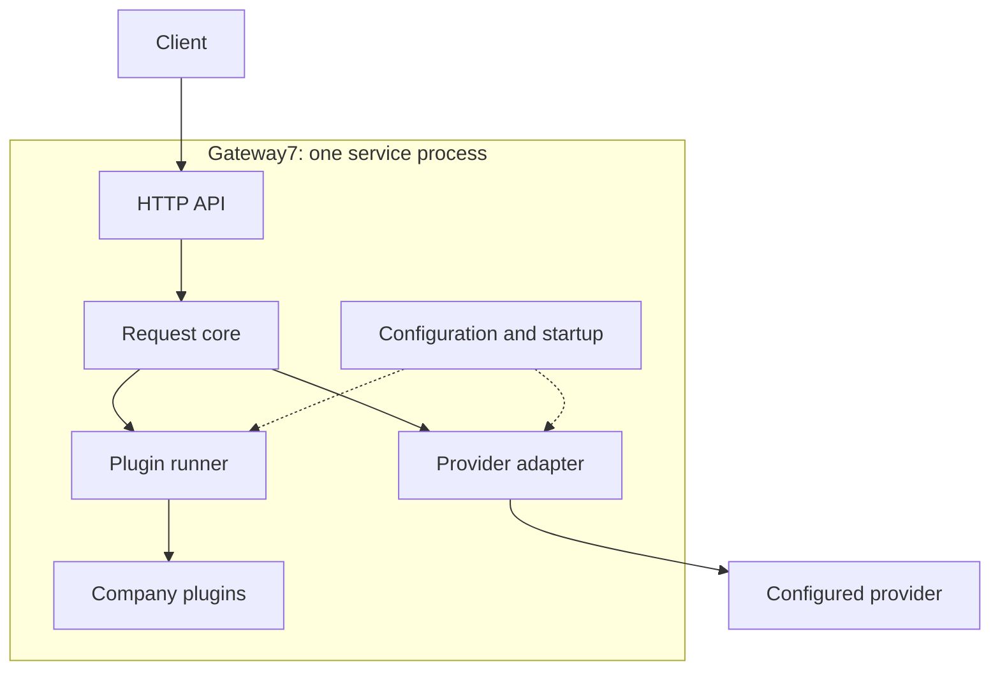
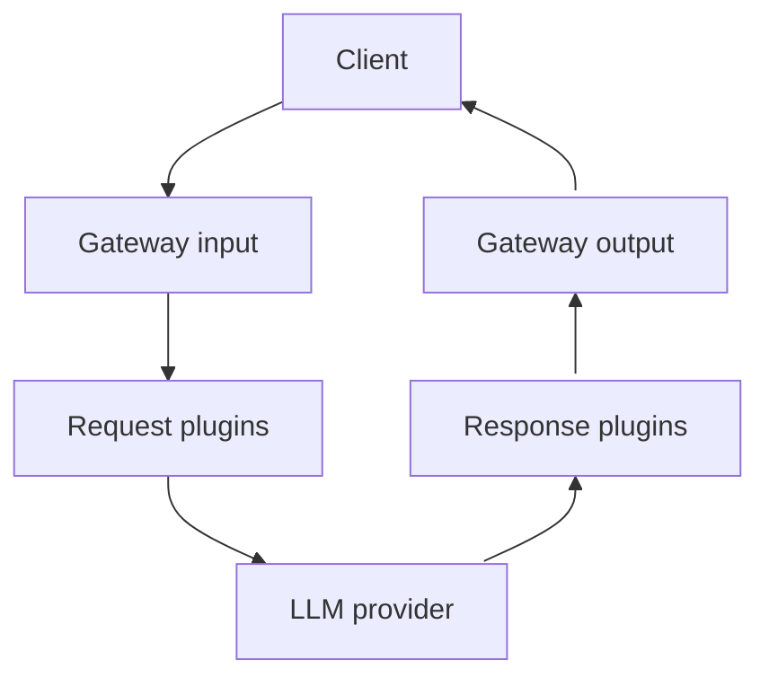

# Gateway7 architecture

**Status:** Python prototype implemented for review, 2026-10-15; deterministic checks do not establish Customer acceptance or the complete MUP.

Gateway7 runs as one service: the core orchestrates company plugins and a single configured provider adapter.
The [product vision](../product-vision.md), [DEC-009](../decisions.md#dec-009)–[DEC-012](../decisions.md#dec-012) require a demonstrable plugin boundary, permit restart-based installation and a deterministic first demo, and retain US-01–03 as the candidate.
[DEC-013](../decisions.md#dec-013) selects Python; [setup](../setup.md), the [customer demo](../demo.md) and the [plugin guide](../plugins.md) describe the runnable implementation.
No story criteria change.

## Components and dependencies

| Component | Responsibility |
| --- | --- |
| HTTP API | Validate input, create context, serialize allowed results and safe errors |
| Request core | Sequence request hooks, one provider call, response hooks and cleanup through interfaces |
| Plugin runner | Invoke ordered hooks, validate results and check deadlines; no company policy |
| Company plugins | Allow, modify or deny content through the shared contract |
| Provider adapter | Translate normalized data, attach the server key and normalize responses/errors |
| Configuration and startup | Load trusted modules, validate settings and construct chains and adapter |

One process avoids separate plugin services and a database, but shares resources and failures.
Plugins depend on the contract in `gateway7/models.py` and `gateway7/plugin_api.py`, not HTTP handlers or provider SDKs; installation changes a module and configuration, not the core.

## Customer view

The request flows down the left to the provider; the response returns up the right to the same Client.
Gateway input, plugins and output belong to the same service.

## Request lifecycle

1. Assign a request ID and validate the text-chat format and size before plugins or forwarding. Reject unsupported fields; create a monotonic deadline and isolated instance state for valid input.
2. Run the request chain. Each hook sees its predecessor's output. `Continue` advances; `Deny` returns a policy error. Exceptions, invalid results and timeouts fail closed with a technical error and **zero upstream calls**.
3. Recheck cancellation/deadline, then call the configured provider once with the processed request and server key. Adaptation, upstream or normalization failures return technical errors without response hooks.
4. Run the independent response chain only after upstream success. A denial blocks delivery but cannot undo provider work or usage.
5. Return the allowed response or core-owned safe error with its request ID while connected. Record a safe outcome and release request-owned state on every exit, including disconnect, once in-flight work unwinds.

The core snapshots validated provider usage before response hooks and preserves it in the successful response; plugin edits cannot replace it.
Absent/invalid usage means **unknown, not zero**; failed/cancelled calls do not imply zero usage. Denied/cancelled calls create no durable usage record; this is request metadata, not billing.

## Data and plugin contract

| Contract | Contents |
| --- | --- |
| Request | Strictly validated ordered plain-text messages, including history, and generation options; provider selection is server configuration. |
| Response | Assistant text and normalized usage when known; no credentials or raw upstream errors. |
| Context | Core-owned request ID and monotonic deadline, with temporary `state` scoped to each request and configured instance. |
| Result | `Continue(payload)` or `Deny(code="policy_denied")`; unchanged payload allows, modified payload transforms. Technical failures are not policy denials. |

Hooks are `on_request(request, context)` and `on_response(response, context)`.
Their configured instance lists are independent: response order is never implicitly reversed; an empty list passes through.
Each listed hook runs once, sequentially; the runner revalidates payloads.
Shared instances keep immutable configuration/concurrency-safe resources; mutable request state belongs in the context.
The [plugin guide](../plugins.md#descriptor-and-hooks) defines descriptors, settings and lifecycle methods; [setup](../setup.md#supported-http-contract) defines the wire schema and limits.

## Loading, trust and limits

Install trusted Python modules, configure instances/settings/order, then restart ([DEC-010](../decisions.md#dec-010)); the [sample installation](../plugins.md#smallest-installation) needs no core edit or package rebuild.
Startup validates YAML, module descriptors/settings, chain references/hooks, initialization and credentials before readiness; failures abort safely.
Even disabled declarations require valid modules/settings; disabled optional instances are omitted from execution.
`required: true` prevents disabling or omitting mandatory filters; **every active hook fails closed**, including optional instances.
Only the adapter receives the server key through ordinary interfaces ([CON-04](../product-vision.md#con-04)); callers cannot select modules or upstream URLs.
**In-process plugins are not sandboxed:** installed code can access memory, environment, files and network, so operators must trust it.

Async cancellation/deadline checks stop later stages and discard late results.
Blocking/uncooperative plugins cannot be forcibly stopped and can delay responsiveness or cleanup; cancelling a provider call does not prove it stopped upstream.
Logs contain only request ID, outcome, safe component/reason codes and durations, excluding content, keys, headers, plugin state and raw errors; fixture capture is synthetic-only.
No original-text restoration/storage, hot loading, streaming, retries/failover, persistent conversations, billing or user-supplied keys; discarding state does not promise secure memory erasure.

## Traceability and first implementation slice

| Source | Implementation and evidence boundary |
| --- | --- |
| [US-01](https://github.com/iteam7/gateway7/issues/30), AC-01–04; CON-04 | Separate HTTP fake-upstream answer/key checks, missing-key startup failure and safe logs/client errors |
| US-01, AC-05; [DEC-011](../decisions.md#dec-011) | Claude Messages adapter has offline tests; actual keyed `pong` remains pending |
| [US-02](https://github.com/iteam7/gateway7/issues/31), AC-01–03; [VP-01](../research/value-proposition.md#vp-01-predictable-local-preflight-for-small-teams) | Exact phone fixtures, history and unchanged order/date text checked |
| [US-03](https://github.com/iteam7/gateway7/issues/32), AC-01–03; [VP-02](../research/value-proposition.md#vp-02-testable-domain-filter-extensions); DEC-009–010 | Module/config-only installation with restart, missing-module failure and A/B order checked |

Tests also cover fail-closed exits, invalid results, independent response order and isolated state.
The response marker demonstrates the interface; US-03 covers request plugins, and no production output policy or separate response-story acceptance is claimed.
Authentication, routing and durable usage accounting remain extension points, outside this slice.

## Review questions and Week 2 follow-up

Architecture and prototype prepare the presentation; Customer evaluation, human review and real-provider AC-05 remain pending.
Review the running hook/loading/error contract, required phone formats and deployment secret source.
Measure concurrent requests, plugin work and latency before claiming capacity; two plugins are a demonstration, not a limit.
