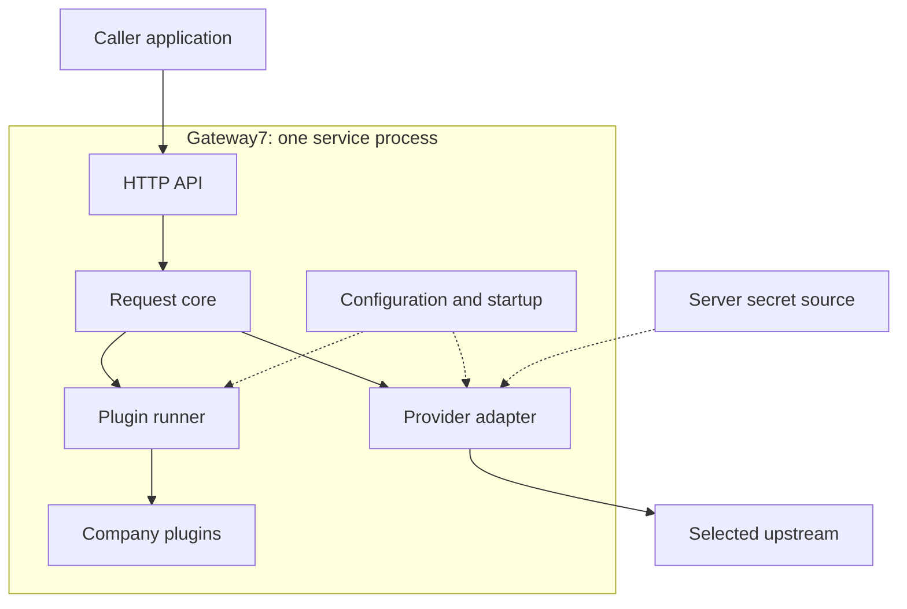
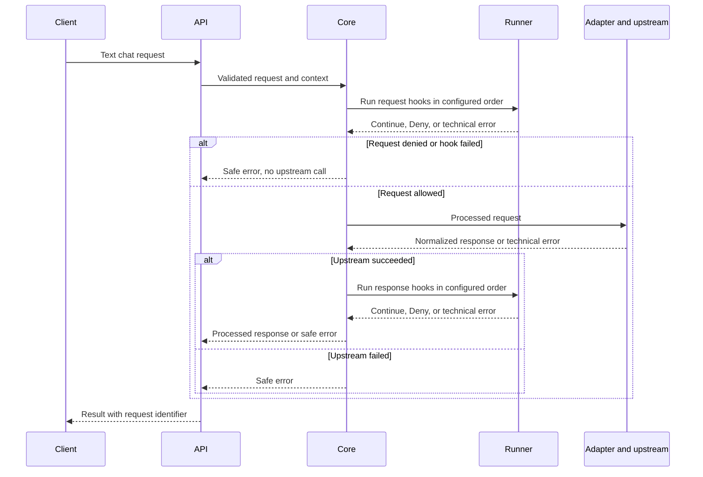

# Gateway7 architecture proposal

**Status:** Proposed for team review, 2026-10-15; preparation for Assignment 3, not an implemented or customer-accepted design.

Gateway7 is proposed as one service with a small orchestration core, company-authored plugins and interchangeable provider adapters.
The core controls execution; plugins implement company policy; adapters handle provider protocols.
This gives [US-03](https://github.com/iteam7/gateway7/issues/32) a concrete extension boundary while keeping the first [US-01](https://github.com/iteam7/gateway7/issues/30) integration small.

## Basis and scope

The [product vision](../product-vision.md) and existing decisions are the source constraints:

- [DEC-009](../decisions.md#dec-009): demonstrate the plugin interface, message flow and integration workflow, with phone masking as one example.
- [DEC-010](../decisions.md#dec-010): installing a plugin may require a restart.
- [DEC-011](../decisions.md#dec-011) and [CON-01](../product-vision.md#con-01): use at most one provider initially; a deterministic upstream is allowed for the first plugin demonstration.
- [DEC-012](../decisions.md#dec-012): US-01, US-02 and US-03 are the approved candidate to build, not accepted implementations.
- [CON-04](../product-vision.md#con-04): keep the provider key in server configuration.

The component split, contracts and failure semantics below are technical proposals for review.
They support [VP-01](../research/value-proposition.md#vp-01-predictable-local-preflight-for-small-teams) and [VP-02](../research/value-proposition.md#vp-02-testable-domain-filter-extensions); they do not establish the narrower competitive-gap hypotheses as facts.
Python or Go remains an open team decision.
This document does not record a stack choice or change a story's acceptance criteria.

## Components and dependencies

Solid arrows show calls; dotted arrows show startup configuration.
The lifecycle below shows replies and early exits.

| Component | Owns | Boundary |
| --- | --- | --- |
| HTTP API | Validate the supported chat input, create request context, serialize results and safe errors | No provider protocol or company policy logic |
| Request core | Request hooks, one upstream call, response hooks and termination | Depends on runner and adapter interfaces, not concrete plugins or provider SDKs |
| Plugin runner | Ordered invocation, result validation, error conversion and deadline checks | Does not detect phone numbers or choose company policy |
| Company plugins | Mask, allow or deny supported content; optionally attach safe decision metadata | Depend on the plugin contract, not HTTP handlers or concrete adapters |
| Provider adapter | Translate normalized data, attach the server key, call upstream and normalize its response/errors | Receives only the request after request hooks; never returns credentials to callers |
| Configuration and startup | Load installed modules, validate settings, construct the runner and selected adapter | The composition point is allowed to know concrete implementations |

Proposed contract types belong to a small shared module.
Adding a provider changes its adapter and configuration; adding a company plugin changes its module and configuration.
The first release needs neither a database nor a separate worker service to perform this flow.
Compared with separate plugin services, one process reduces deployment and protocol work but shares failures and resources.
Compared with hard-coded masking in the core, the plugin boundary lets the company replace its policy without a fork ([US-02](https://github.com/iteam7/gateway7/issues/31), US-03).

## Request lifecycle

Invalid client input stops at the API before any hook or upstream call.
Every hook sees the output of the preceding hook in its own chain.
A response denial happens after the upstream call: it prevents delivery to the caller but cannot undo provider work or usage.
The response chain runs only after a successful upstream result; it is not an error handler.

## Data and plugin contract

These are language-neutral semantics, not a finalized wire schema or SDK.
The initial operation is one non-streaming text chat completion.
Reject unsupported content, such as attachments or tool payloads, rather than forwarding unexamined fields.

| Contract | Proposed contents and rules |
| --- | --- |
| Chat request | An ordered conversation of messages with a supported role and plain-text content; a small validated set of generation options. All supported messages are visible to request hooks, including earlier history. Provider selection comes from server configuration. |
| Chat response | Assistant text and normalized completion metadata. Preserve provider-reported usage if present; absent usage is unknown, not zero. No provider credentials or raw upstream error body. |
| Request context | Core-owned request ID, start time, deadline and cancellation signal; a separate namespace of temporary state for each plugin. Identity can be added when authentication is implemented. |
| Plugin result | `Continue(processed_payload, safe_metadata)` or `Deny(reason_code, safe_message)`. Unchanged payload means allow; modified payload includes masking. Exceptions, invalid results and timeouts are technical errors, not policy denials. |

A plugin declares a stable ID, supported contract version, implemented hooks and validated settings.
The two hooks are `on_request(request, context)` and `on_response(response, context)`.
A plugin implements only the hooks it needs; naming a missing hook in a configured chain is a startup error.
The runner validates returned payloads before continuing.
The public contract provides no core-forwarding callback or provider-key field.

**Ordering:** configuration contains separate ordered request and response lists of plugin IDs.
Response order is not implicitly reversed from request order.
For example, request list A then B yields A's marker before B's; a response list B then A is independently configured.
Each referenced hook runs once at its listed position; no retries or parallel hooks within one request.
Reject duplicate IDs within one chain and unknown references at startup.
Ordering is part of policy: a later trusted plugin can modify earlier output, so the configured full chain must be checked on fixtures.

**State and concurrency:** different requests may run concurrently and share loaded plugin instances.
Instances keep immutable configuration or concurrency-safe service resources, never a shared mutable current request.
Per-request counters and similar hook state live in that request's plugin namespace and are discarded at completion.
Do not create restoration maps or persist original unmasked text; [BND-02](../product-vision.md#bnd-02) excludes restoration storage.
The contract does not promise secure erasure of transient process memory.

## Loading, readiness and errors

At startup, read configuration, resolve installed trusted modules, check contract compatibility and settings, and construct both chains and the selected adapter.
Validate required credentials, including the test key in the fake-upstream configuration.
Only report ready and accept chat requests after all checks succeed.
A missing plugin, invalid chain, failed initialization or missing key aborts startup with a safe message naming the relevant plugin or setting.
Do not silently skip a configured plugin or print configuration values.

The operator installs a plugin, lists its ID/module/settings and hook position, then restarts Gateway7.
No request may select arbitrary modules or supply an upstream URL.
Exact module packaging depends on the stack decision; the chosen mechanism must satisfy US-03 without core edits.
Hot loading and an untrusted plugin marketplace remain outside scope ([DEC-010](../decisions.md#dec-010), [BND-04](../product-vision.md#bnd-04)).

| Outcome | Proposed behavior |
| --- | --- |
| Continue | Pass the processed payload to the next hook or next core stage |
| Policy denial | Stop the chain and return a stable policy error with safe metadata |
| Plugin exception, invalid result or timeout | Stop the request; never bypass a mandatory filter. Initially every configured hook is required; there is no fail-open mode. |
| Upstream failure | Return a normalized technical error; no response hooks, automatic retry or failover |
| Cancellation or expired deadline | Stop further stages, signal cooperative plugin/upstream work to stop, and discard late results |

The core checks cancellation/deadline before each stage and after a hook returns, including immediately before forwarding.
An in-process timeout cannot forcibly terminate arbitrary blocking or uncooperative plugin code, or guarantee that the API remains responsive while it blocks.
Nor does cancelling a provider call prove that the provider stopped processing it.
Trusted plugin authors must use cooperative cancellation and bounded work; stronger isolation would require a separate execution boundary.
Concrete time budgets and HTTP error codes must be fixed with the API contract before implementation.

## Provider and observation boundaries

The adapter exposes one completion operation over normalized request/response types.
Startup selects a single configured implementation: a deterministic fake-upstream adapter for fixtures, or one real Claude/Gemini adapter after the provider is chosen.
Use an HTTP fake upstream for US-01 checks so request contents and test-key propagation can actually be observed.
A static in-memory response is useful for a hook demo but cannot establish those transport criteria.

Credentials go from a server secret source to the adapter; callers and ordinary plugin inputs do not receive them.
This interface boundary is **not a sandbox**: code installed in the same process can access process memory, environment, files or the network.
The operator must trust and review installed plugins; the design does not contain malicious plugin code.
Secret-manager integration remains open; the existing constraint permits server configuration such as an uncommitted `.env`.

Record request ID, outcome, safe reason code, component/plugin ID and durations.
Default logs and telemetry exclude prompts, responses, authorization headers, keys, plugin state and raw exception or upstream bodies.
Use sanitized error codes rather than logging arbitrary plugin exception text.
Keep metric labels bounded; request IDs belong in logs, not metric labels.
The isolated fake upstream may capture synthetic fixtures for verification, never production conversations.
Optional usage metadata is not a usage ledger or billing feature ([BND-03](../product-vision.md#bnd-03)).

## Traceability and first implementation slice

| Source | What this proposal enables | Evidence still required |
| --- | --- | --- |
| [US-01](https://github.com/iteam7/gateway7/issues/30), AC-01–04; CON-04 | One configured adapter with a server-held key | Fake-upstream answer, test-key forwarding, no-key startup failure, and absence of that key in client responses/logs |
| US-01, AC-05; DEC-011 | Replace the fake adapter with one real provider | Actual Claude/Gemini call returning `pong`; deterministic-demo approval does not pass AC-05 |
| [US-02](https://github.com/iteam7/gateway7/issues/31), AC-01–03; VP-01 | Phone masking before the adapter, over the conversation history | All three specified phone formats replaced with `[PHONE]`, earlier-message coverage, benign order/date text unchanged |
| [US-03](https://github.com/iteam7/gateway7/issues/32), AC-01–03; VP-02; DEC-009–010 | Configured plugin modules, startup validation and explicit order | Add the sample marker plugin with only its module/config changed, fail startup for a missing module, show A then B marker order |
| DEC-012 | Keep the approved three-story candidate traceable | Implementation and customer acceptance against each story's AC; no story is completed by this document |

After settling the stack and API contract, build the smallest runnable slice: HTTP API, core, request runner, phone plugin, sample marker plugin and HTTP fake upstream.
Check the existing story fixtures above, plus denial/error causing zero upstream calls, invalid-result handling, request-state isolation and metadata-only logs.
Then integrate the selected real provider and run US-01 AC-05.
These are proposed checks, not reported test results or a change to the candidate.

Response hooks are designed here to avoid coupling the core to request-only policy, but US-03 covers request plugins.
Implementing response plugins is a later capability; an initially empty response chain must not be described as delivered response filtering.
Authentication belongs before content handling, future routing before adapter dispatch, and durable usage accounting at the outcome boundary, including response denials and failed calls with unknown usage.
Those are extension points, not promises in this first slice.
Streaming, automatic retries/failover, persistent conversations, billing and user-supplied provider keys are not introduced by this proposal.

## Review questions and Week 2 follow-up

This prepares the technical architecture, including organization of the core and plugin integration, for the next customer presentation.
Presentation, customer evaluation and the separately promised technical prototype are still pending evidence.

Before implementation, the team must settle Python or Go and its plugin packaging, the first real provider, the exact HTTP/schema contract, and time/input-size limits.
Record adopted technology choices as `DEC-nnn` entries and significant architectural choices as ADRs when agreed; this proposal creates neither an invented approval nor a new customer decision.
Bring the proposed hook/loading/error contract to review and confirm the deterministic-demo versus complete-candidate sequence.
The plugin capacity question remains open: two plugins are a demonstration, not a capacity ceiling.
Measure concurrent requests, plugin work and latency before stating a supported limit.
