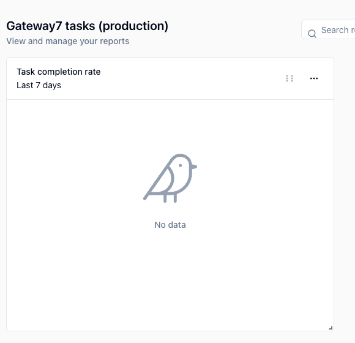
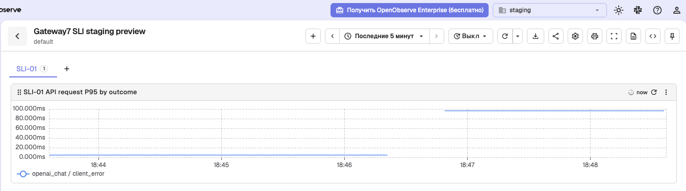
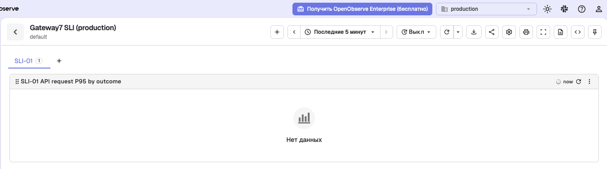

# Week 06 report — Gateway7

## Scope and findings

Gateway7 is Team 7's modular LLM gateway with configurable company policy plugins.
This report indexes the implementation at [main checkpoint `8c01844489eff52b3211869a68e9f7f6576cb019`](https://github.com/iteam7/gateway7/tree/8c01844489eff52b3211869a68e9f7f6576cb019), the operator evidence from 7 November, the completed threshold review in [task #187](https://github.com/iteam7/gateway7/issues/187), and the unfulfilled Customer Review in [task #188](https://github.com/iteam7/gateway7/issues/188).
The immutable evidence links identify the original captures, whose artifacts are now integrated on main; this checkpoint does not claim that the final release or submission is complete.
On 7 November 2026, azamatbayramov reported that the team had not held its Week 6 Customer Review because the demonstration was not ready.
This is a team-preparation shortfall, not a claim that Customer was unavailable or refused a meeting or recording.
The earlier outline approval concerned a plan; it supplies no meeting outcome, Customer verdict, permission answer or agreed action.
The [archived live script](live-review-script.md) preserves the unused preparation byte for byte from [the 6 November version](https://github.com/iteam7/gateway7/blob/2b81c3c21e8052066f124ac158c56181fef4d18a/reports/week-06/meeting-script.md).
The canonical [meeting script](meeting-script.md) was prepared for a possible written asynchronous exchange and remains unused.
Neither script is evidence that a Review occurred.
On 8 November, azamatbayramov confirmed that no Customer Review would take place before the assignment deadline and approved the [team retrospective](sprint-retrospective.md).
The subsequent source/acceptance reconciliation completed US-04 and the narrow tasks #181/#183/#186; the completed-story snapshot is 5 SP, separate from the 21-SP later scope estimate and pending formal Actual Velocity.
The [release preparation](release-preparation.md) proposes a consistent `0.4.0` package/runtime/OpenAPI version and an upgrade note; it does not publish REL-06.

## Customer Review not held

No live or asynchronous Week 6 Customer Review was held, and the contributor confirmed on 8 November that none would take place before the assignment deadline.
Consequently, meeting date, duration, attendees and per-meeting permission answers are not applicable to a completed Review; no recording or transcript of such a Review is available for this submission record.
There is no Customer acceptance of US-14 or US-15, no new Customer threshold decision, and no Customer-agreed Week 7 action to report.
The proposed analytics check by iceberkut on 10 November and the proposed blocking-plugin investigation by DeniBorsh on 12 November remain proposals, not agreed commitments.
No canonical `meeting-report.md` is created for this non-event.

The [course permits a written asynchronous Review](https://github.com/inno-itpd/itpd/blob/c2e737f7a16221e9fcdaf4234b045baca9cd0c6e/requirements/customer-meetings-requirements.md#every-meeting) when a live meeting is impossible.
Its timestamped exchange with Customer is the transcript; the substitution must be declared as a deviation.
The packet is retained as unused preparation; it will not supply a written Review for this submission.
The decision to submit without that Review does not satisfy or waive the missing validation requirement.
Task #188 remains open until an actual Review and its required outcomes are evidenced.

The hard submission deadline remains **8 November 2026, 23:59**, with no soft deadline.
The [deviation rule](https://github.com/inno-itpd/itpd/blob/c2e737f7a16221e9fcdaf4234b045baca9cd0c6e/requirements/weekly-report-requirements.md#declaring-deviations) does not waive an unfulfilled requirement.
If the remaining work cannot be verified before submission, the report must retain these gaps rather than claim a completed Review, release or test.

Two threshold measures are already supported by existing evidence: the recorded company-plugin installation and the contributor-reported Customer acceptance of the candidate.
The two original Week 3 measures still need their historical evidence assessed; later code, a green workflow or a current dashboard cannot establish what happened by their deadline.
Their deadlines are not extended.

The [analytics plan](../../docs/analytics.md) defines the focus metric, successful gateway tasks per week, its metric tree, event contract and queries.
Merged [PR #196](https://github.com/iteam7/gateway7/pull/196) closed [task #177](https://github.com/iteam7/gateway7/issues/177) for its source-level criteria and brought typed start/completion events, the optional OpenPanel exporter and FR-015 onto main.
It preserved the team's QR-05, canonical QRT script and dashboard definition from [PR #194](https://github.com/iteam7/gateway7/pull/194) and [PR #195](https://github.com/iteam7/gateway7/pull/195), with the telemetry runbook, proposed ADR-006/007, feature entries and external-backend container view.
[PR #193](https://github.com/iteam7/gateway7/pull/193) supplies OTLP request-duration histogram and structured-log export, FR-014 and Active SLI-01.
The source-check workflows linked below passed on their recorded main checkpoint; they are not deployment measurements.

The operator's [analytics deployment record](https://github.com/iteam7/gateway7/blob/1a4b47e3e88879f45c0bf689989c39d08fcfa0d5/docs/deployment.md#prepare-the-backends) reports a university-VM OpenPanel stack, separate projects and staging smoke delivery from an isolated candidate.
The [staging analytics check](https://github.com/iteam7/gateway7/blob/5e6f9318f5ba804516da3832000067635defc170/reports/week-06/analytics-staging.md) records two `chat_started` events when unfiltered and no series after applying the smoke exclusion.
Its task-completion-rate chart is `No data`, not a measured zero; a production focus-metric value or a numeric result for the defined non-smoke metric is not established.
OpenPanel retention over the full seven-day metric window remains unverified.
The [observability deployment record](https://github.com/iteam7/gateway7/blob/b68632db58bad62dfe994a39dc722b324c0e5bf4/docs/deployment.md#prepare-the-backends) reports separate organizations, own-organization query success and cross-organization HTTP 401.
The installed query identities have organization-administrator privileges; they are not claimed to be read-only Customer accounts.

The [VM-hosted candidate QRT record](https://github.com/iteam7/gateway7/blob/f2422900384c78606bcfffa4c730b9e6441b25a8/reports/week-06/qrt-05-preview.md) reports `PASS QR-05 QRT-01` for candidate commit `22ecc152f57ad096cd942050cd46d6d3457fb93d`: the failed request's log was queryable in 1.046 seconds and its five-minute failure P95 in 4.144 seconds.
A repeat through SSH forwarding reports 1.101 and 6.218 seconds.
These are actual operator-recorded candidate results, distinct from the earlier local synthetic checks; the candidate's revision and target remain operator assertions.
The prepared record does not supply the matching request identifier and complete sanitized log-query output, and the regular staging and production gateways have not been promoted and verified.
The [testing plan](../../docs/project-plan.md#quality-requirement-testing-plan) therefore retains `Not verified` for the regular deployed check until the required evidence is recorded.
A separate core-task request returned HTTP 502, and the operator's direct provider check reported a country or territory restriction; this does not establish that the key is invalid.
That outbound provider restriction does not prevent the QRT's deliberately forbidden-model request, which is rejected before a provider call.
The four sanitized dashboard captures are indexed below; empty production views and a passing candidate check do not complete the regular deployment, Customer Review or REL-06.

The minimum usable product candidate remains US-01, US-02 and US-03, per [DEC-012](../../docs/decisions.md#dec-012).
Their reported acceptance is recorded separately in [DEC-020](../../docs/decisions.md#dec-020) and the [Week 5 contributor confirmation](../week-05/meeting-follow-up.md#customer-verdicts).
That confirmation supplements the transcript-only account; it does not turn a later check into evidence shown at the earlier meeting.

## Threshold review

All four goals were `Open` when the threshold-document review began.
The table preserves each measure as written; the [threshold](../../docs/threshold-of-success.md) owns the settled goals' outcomes.

| Goal | Current measure | New data can settle it | Proposal |
| --- | --- | --- | --- |
| [TOS-01](../../docs/threshold-of-success.md#tos-01) | A reviewer following `docs/setup.md` from a clean checkout sends a chat request and gets a filtered response, covering US-01, US-02 and US-03, by the Week 3 deadline. | No — event counts and request timings do not show that a reviewer followed those instructions without patching by the original deadline. A dated, matching clean-checkout record is needed. | — |
| [TOS-02](../../docs/threshold-of-success.md#tos-02) | The phone-number masking plugin's offline fixture suite ([VP-01](../../docs/research/value-proposition.md#vp-01-predictable-local-preflight-for-small-teams)) passes its positive, negative and error cases, with no raw payload in the default audit log, by the Week 3 deadline. | No — telemetry cannot prove exact fixture expectations or the absence of raw audit payload by that deadline. The existing [technical evidence matrix](../../docs/demo.md#acceptance-checklist) and historical fixture records need that exact comparison. | — |
| [TOS-03](../../docs/threshold-of-success.md#tos-03) | A second, previously unwritten plugin is installed and exercised through configuration alone ([VP-02](../../docs/research/value-proposition.md#vp-02-testable-domain-filter-extensions)), with no edit outside its plugin and configuration files, by Week 4. | No — a successful request does not prove which files changed. The dated installation record, rather than telemetry, settles this measure. | — |
| [TOS-04](../../docs/threshold-of-success.md#tos-04) | A `DEC-nnn` records Customer's verdict on US-01, US-02 and US-03 in a Week 3 or later meeting report. | No — usage and operational signals cannot establish Customer acceptance. The recorded verdict is the evidence this measure requires. | — |

[TOS-01](../../docs/threshold-of-success.md#tos-01) remains `Open`.
[TOS-02](../../docs/threshold-of-success.md#tos-02) remains `Open`.
[TOS-03](../../docs/threshold-of-success.md#tos-03) is `Achieved`.
[TOS-04](../../docs/threshold-of-success.md#tos-04) is `Achieved`.

No analytics-measured goal or replacement measure is proposed: none of these four measures is settled by a product-event count or operational time series, and the published metric contract measures current requests rather than the original dated checks or Customer verdicts.
The [earlier clarification draft](../../docs/threshold-review.md) is unadopted proposal history, not a Customer decision or permission to reset expired dates.
In particular, its proposed October acceptance date is not the current TOS-04 measure and is not applied to the now-settled goal.
Any new or revised success bar needs an explicit Customer decision; no such decision is invented here.

## Review readiness

The table distinguishes source completion, the original operator-recorded candidate observations and outstanding submission work at the 8 November reconciliation.
The source checkpoint is [`8c01844489eff52b3211869a68e9f7f6576cb019`](https://github.com/iteam7/gateway7/tree/8c01844489eff52b3211869a68e9f7f6576cb019), including the policy reconciliation in PR #209 and confirmed retrospective in PR #211.
The original capture dates and their candidate scope are retained.
An owner issue, prepared configuration or source-level workflow does not prove a regular deployment.
Backend, dashboard and query addresses, credentials and the private CA handoff belong in the Moodle PDF.

| Assignment 6 evidence | Source or owner | Status at this checkpoint |
| --- | --- | --- |
| Existing gateway product cases | [Demo guide](../../docs/demo.md), [authoring walkthrough](../../docs/authoring.md#try-the-installed-package-without-a-provider-account), [DEC-020](../../docs/decisions.md#dec-020) | Earlier acceptance remains separate. The new isolated candidate's core-task check returned 502; successful current provider access is not established. |
| Sprint goal, selection and velocity | [Project plan](../../docs/project-plan.md#sprint-06), [#176](https://github.com/iteam7/gateway7/issues/176) | Due is 8 November. US-04 supplies 5 completed SP after source and acceptance reconciliation; US-14/US-15 remain open at 8 SP each. The 21-SP later scope estimate is not original Planned Velocity or final Actual Velocity; carryover remains a proposal. |
| New stories and traceability | [US-14 #174](https://github.com/iteam7/gateway7/issues/174), [US-15 #175](https://github.com/iteam7/gateway7/issues/175), [#186](https://github.com/iteam7/gateway7/issues/186) | Task #186 is completed against its documentation criteria, with FR-014/015, proposed ADR-006/007, feature entries and the external-backend container view. US-14/US-15 still need their runtime criteria and Customer verdicts. |
| Analytics tree, events and computed query | [Analytics plan](../../docs/analytics.md), [staging check](https://github.com/iteam7/gateway7/blob/5e6f9318f5ba804516da3832000067635defc170/reports/week-06/analytics-staging.md), [#178](https://github.com/iteam7/gateway7/issues/178) | Typed events are merged. The candidate's smoke event and exclusion were inspected; the unfiltered start count was two, while the filtered metric chart had no series. No production focus value or numeric non-smoke metric result is claimed. |
| Observability signals and Active SLI | [SLI-01](../../docs/observability.md#sli-01), [candidate record](https://github.com/iteam7/gateway7/blob/f2422900384c78606bcfffa4c730b9e6441b25a8/reports/week-06/qrt-05-preview.md) | Task #181 is completed for native OTLP logs, the delta histogram and specification links; #183 is completed for the staging SLI view. The candidate exported a numeric failure series; regular deployment verification remains separate. |
| Analytics backend and dashboards | [Backend record](https://github.com/iteam7/gateway7/blob/1a4b47e3e88879f45c0bf689989c39d08fcfa0d5/docs/deployment.md#prepare-the-backends), [staging](https://github.com/iteam7/gateway7/blob/5e6f9318f5ba804516da3832000067635defc170/reports/week-06/analytics-staging.md), [production](https://github.com/iteam7/gateway7/blob/8c07840e83d292f7a10ffc943202fc6cb3d54ea4/reports/week-06/analytics-production.md) | Separate OpenPanel projects and the two L1 chart captures are recorded. Regular gateways still need promotion and connection; seven-day retention and Customer access are unverified. |
| Observability backend and dashboards | [Backend record](https://github.com/iteam7/gateway7/blob/b68632db58bad62dfe994a39dc722b324c0e5bf4/docs/deployment.md#prepare-the-backends), [staging](https://github.com/iteam7/gateway7/blob/f880539b653030c0b29a7e298f84d7f348fe015a/reports/week-06/observability-staging.md), [production](https://github.com/iteam7/gateway7/blob/0f3d1b6f114be3a0adf745e8061e517b65834532/reports/week-06/observability-production.md) | Organization isolation and the two SLI-01 views are recorded. Staging shows the candidate's numeric failure series; production is empty and unexercised. Query identities are not least-privilege read-only accounts. |
| New analysability QR and QRT | [QR-05](../../docs/quality-requirements/qr/QR-05.md#qrt-01), [candidate record](https://github.com/iteam7/gateway7/blob/f2422900384c78606bcfffa4c730b9e6441b25a8/reports/week-06/qrt-05-preview.md), [#185](https://github.com/iteam7/gateway7/issues/185) | Candidate PASS is recorded at the asserted revision. The complete matching log-query/request-ID evidence and a verified regular-staging run are still needed before changing its testing-plan row. |
| Four sanitized dashboard captures | [Dashboard evidence](#dashboard-and-candidate-evidence) | All four prepared views are linked by immutable source commit, with an additional staging smoke-detail capture. Their scopes and empty-chart limitations are stated below. |
| Customer Review and threshold response | [#188](https://github.com/iteam7/gateway7/issues/188), [no-Review record](#customer-review-not-held) | No live or written Week 6 Review, new Customer DEC, story verdict or agreed Week 7 action is established. |
| Retrospective and completed scope | [Team retrospective](sprint-retrospective.md), [#190](https://github.com/iteam7/gateway7/issues/190) | The contributor confirmed the held retrospective and four carried actions. The completed-story snapshot is 5 SP from US-04; formal Actual Velocity, carryover and sprint closeout remain pending. |
| REL-06 | [Readiness record](release-readiness.md), [#189](https://github.com/iteam7/gateway7/issues/189) | The 0.4.0 candidate and upgrade-note draft are prepared. Provider access, complete final deployment/query evidence, release decision and protected final tag remain outstanding; Customer Review is explicitly unfulfilled. |
| Private PDF and repository ZIP | [#189](https://github.com/iteam7/gateway7/issues/189) | The final merged-main revision, full private access handoff and matching Week 6 PDF/ZIP are not complete; no Moodle upload is claimed. |
| Optional runtime-QRT re-run | [Testing plan](../../docs/project-plan.md#quality-requirement-testing-plan) | No optional new run is claimed. Earlier Week 5 results retain their recorded revision, sprint and level. |

## Dashboard and candidate evidence

These are sanitized operator captures from 7 November, not newly generated traffic or measurements by this report update.
The immutable source links retain the original evidence while the prepared files are integrated into main.

### Analytics staging

[The staging record](https://github.com/iteam7/gateway7/blob/5e6f9318f5ba804516da3832000067635defc170/reports/week-06/analytics-staging.md) describes a smoke request from the isolated candidate and the count query used to inspect its exclusion.
The chart is the tree's L1 input, `Task completion rate`, over seven days: `No data` after excluding smoke is not a measured zero.

The [smoke detail](https://raw.githubusercontent.com/iteam7/gateway7/5e6f9318f5ba804516da3832000067635defc170/reports/week-06/images/analytics-staging-smoke.png) shows `environment=staging`, `source=smoke`, `status=401` and `outcome=client_error`.
It is not a successful provider request or evidence of production use.

### Analytics production

[The production record](https://github.com/iteam7/gateway7/blob/8c07840e83d292f7a10ffc943202fc6cb3d54ea4/reports/week-06/analytics-production.md) reports the same L1 chart recipe with the production project's own credential and no synthetic traffic.
The regular production gateway still needs promotion and connection; the empty chart has no measured completion rate.

### Observability staging

[The staging record](https://github.com/iteam7/gateway7/blob/f880539b653030c0b29a7e298f84d7f348fe015a/reports/week-06/observability-staging.md) names the VM-hosted candidate and the SLI-01 query.
Its separate `openai_chat / client_error` series is numeric; it does not assert promotion of the regular staging gateway.

### Observability production

[The production record](https://github.com/iteam7/gateway7/blob/0f3d1b6f114be3a0adf745e8061e517b65834532/reports/week-06/observability-production.md) describes the same SLI-01 chart and query, with no synthetic failure sent to production.
This empty view is configuration evidence, not a current production availability measurement.

### Candidate result and access limits

The [candidate QRT record](https://github.com/iteam7/gateway7/blob/f2422900384c78606bcfffa4c730b9e6441b25a8/reports/week-06/qrt-05-preview.md) retains both measured PASS summaries and their stated limitations.
A full sanitized matching log-query response with its request identifier and verification after promotion remain outstanding.
Keep the actual candidate result distinct from that missing final evidence rather than repeating the check solely because the core provider call is blocked.

The [TLS setup](https://github.com/iteam7/gateway7/blob/1a4b47e3e88879f45c0bf689989c39d08fcfa0d5/docs/deployment.md#tls-access-to-the-telemetry-backends) requires the private internal CA certificate and fingerprint for clients.
A browser or curl health check with that CA is not proof that the [native QRT client](../../scripts/check_sli.py) trusts it: use the documented VM-loopback or SSH-forwarded internal HTTP path for the current operator check.
Neither disabling certificate verification nor publishing endpoints or credentials is part of this handoff.

## Prior follow-up evidence

This evidence map preserves the preparation sources and does not retrospectively change Week 5.
Carry this table into an actual future live or written Review to distinguish earlier recorded outcomes from questions that still need an answer.
The [script](meeting-script.md) includes the proposed blocking-plugin follow-up; it does not turn that proposal into a completed investigation or an agreed assignment.

| Prior item | Work since and evidence | What the Review still needs to settle |
| --- | --- | --- |
| [Week 5 action: three or four substantial demonstrations](../week-05/meeting-report.md#action-points) | The [confirmed coordination plan](../week-05/meeting-follow-up.md#confirmed-follow-up-plan), demo/authoring guides and the prepared script provide the presentation route. DEC-020 records the earlier named verdicts. | Present the deployed cases against exact ACs; obtain named verdicts for US-14/US-15 only after their evidence is ready. Do not re-create earlier acceptance from a new demonstration. |
| [Week 5 action: investigate blocking plugins](../week-05/meeting-report.md#action-points) | [#157](https://github.com/iteam7/gateway7/issues/157) records the bounded experiment and remains open. The current setup guide states the trusted, cooperative execution limit. | Obtain the experiment's measured results and choose any next step explicitly; no isolation architecture or completed investigation is assumed. |
| [Week 5 action: infrastructure, capacity, secrets and permissions](../week-05/meeting-report.md#action-points) | [#135](https://github.com/iteam7/gateway7/issues/135) and the [Week 5 quality record](../week-05/quality-checks.md) provide technical CI/DoD evidence; contributor follow-up records the earlier answers that exist. | Obtain the remaining Customer closing answer and separate workload, secret-storage and per-meeting permission answers. Green CI is not Customer confirmation. |
| [Earlier question: candidate/provider verdict](../week-05/meeting-report.md#open-questions) | [DEC-020](../../docs/decisions.md#dec-020) and [DEC-021](../../docs/decisions.md#dec-021) record acceptance and OpenAI clarification on contributor-provided evidence. | Carry those recorded answers into the follow-up table when an actual Review is reported, retaining their provenance. Exact unresolved US-04 error criteria remain separate. |
| [Earlier questions: execution, capacity, secrets and transcript permissions](../week-05/meeting-report.md#open-questions) | The existing guides describe the implementation; #157 tracks the unresolved blocking case. No Customer workload, external-secret-manager choice or missing permission answer is inferred. | Ask the still-open questions in the script and retain any unanswered item with a concrete follow-up. |

## Coverage

This table follows the Assignment 6 report's required coverage order.
Maintained artifacts use repository-relative paths; the integrated runtime records retain immutable original source links and their original capture times and environment limits.
The [readiness table](#review-readiness) distinguishes source, candidate evidence and incomplete regular deployment.

| Deliverable | Artifact |
| --- | --- |
| Sprint plan and new stories | [docs/project-plan.md#sprint-06](../../docs/project-plan.md#sprint-06), [US-14 #174](https://github.com/iteam7/gateway7/issues/174), [US-15 #175](https://github.com/iteam7/gateway7/issues/175). The later scheduled scope is 21 SP, with a current 5-SP completed-story snapshot from US-04. Original planning commitment, final Actual Velocity and the next two sprints' confirmed selection remain unestablished. |
| Analytics plan | [docs/analytics.md](../../docs/analytics.md) owns the four-metric tree, seven-criterion justification and queries. [The staging record](https://github.com/iteam7/gateway7/blob/5e6f9318f5ba804516da3832000067635defc170/reports/week-06/analytics-staging.md) demonstrates smoke inspection and exclusion, not a production metric value or numeric non-smoke completion rate. |
| Events and instrumentation | [docs/analytics.md#the-events](../../docs/analytics.md#the-events), [gateway7/analytics.py](../../gateway7/analytics.py), [FR-015](../../docs/functional-requirements/fr/FR-015.md), and the [staging smoke detail](https://raw.githubusercontent.com/iteam7/gateway7/5e6f9318f5ba804516da3832000067635defc170/reports/week-06/images/analytics-staging-smoke.png). The smoke request used an isolated candidate, not the promoted regular deployment. |
| Analytics dashboards | [Staging evidence](https://github.com/iteam7/gateway7/blob/5e6f9318f5ba804516da3832000067635defc170/reports/week-06/analytics-staging.md) and [production evidence](https://github.com/iteam7/gateway7/blob/8c07840e83d292f7a10ffc943202fc6cb3d54ea4/reports/week-06/analytics-production.md), with both sanitized captures in [dashboard evidence](#dashboard-and-candidate-evidence). The L1 charts are empty, not measured zeros. |
| Observability plan and SLIs | [docs/observability.md](../../docs/observability.md) owns Active SLI-01 and its queries; the [candidate record](https://github.com/iteam7/gateway7/blob/f2422900384c78606bcfffa4c730b9e6441b25a8/reports/week-06/qrt-05-preview.md) and [staging view](https://github.com/iteam7/gateway7/blob/f880539b653030c0b29a7e298f84d7f348fe015a/reports/week-06/observability-staging.md) report the VM preview's observations. |
| Observability dashboards | [Staging evidence](https://github.com/iteam7/gateway7/blob/f880539b653030c0b29a7e298f84d7f348fe015a/reports/week-06/observability-staging.md), [production evidence](https://github.com/iteam7/gateway7/blob/0f3d1b6f114be3a0adf745e8061e517b65834532/reports/week-06/observability-production.md), and [monitoring/openobserve/gateway7-sli-dashboard.json](../../monitoring/openobserve/gateway7-sli-dashboard.json). The candidate's failure P95 is numeric; the regular production view is empty. |
| Feature documentation | [docs/features.md#understand-core-task-completion](../../docs/features.md#understand-core-task-completion) and [docs/features.md#diagnose-a-failed-request](../../docs/features.md#diagnose-a-failed-request) document both internal capabilities and their specification links. |
| Functional requirements | [docs/functional-requirements/README.md](../../docs/functional-requirements/README.md), [FR-014](../../docs/functional-requirements/fr/FR-014.md) and [FR-015](../../docs/functional-requirements/fr/FR-015.md). Runtime verification of all their criteria is not inferred from source tests. |
| ADRs and container view | [docs/architecture/README.md#architectural-decisions](../../docs/architecture/README.md#architectural-decisions), proposed [ADR-006](../../docs/architecture/adr/ADR-006.md) and [ADR-007](../../docs/architecture/adr/ADR-007.md), and the [container view](../../docs/architecture/README.md#container-view). The two self-hosted backends remain external systems. |
| Observability requirement | [QR-05 QRT-01](../../docs/quality-requirements/qr/QR-05.md#qrt-01), [scripts/check_sli.py](../../scripts/check_sli.py), [testing plan](../../docs/project-plan.md#quality-requirement-testing-plan), and the [candidate PASS record](https://github.com/iteam7/gateway7/blob/f2422900384c78606bcfffa4c730b9e6441b25a8/reports/week-06/qrt-05-preview.md). Regular staging remains `Not verified` pending promotion and complete matching evidence. |
| Runtime test re-run | [Testing plan](../../docs/project-plan.md#quality-requirement-testing-plan): no optional new re-run is claimed, and earlier results retain their original scope. |
| Threshold review | [docs/threshold-of-success.md](../../docs/threshold-of-success.md), [docs/threshold-review.md](../../docs/threshold-review.md) and [this review](#threshold-review) preserve original measures, deadlines and evidence-backed statuses. |
| Week 5 action points | [Week 5 actions](../week-05/meeting-report.md#action-points) and [prior follow-up evidence](#prior-follow-up-evidence). No new `meeting-report.md#previous-action-points` is invented before an actual Review. |
| Week 5 open questions | [Week 5 questions](../week-05/meeting-report.md#open-questions), [contributor follow-up](../week-05/meeting-follow-up.md), and [prepared questions](meeting-script.md#questions). Unanswered items remain open. |
| Meeting script | [Proposed written script](meeting-script.md) and [unused live archive](live-review-script.md). Neither supplies a Customer response or completed Review. |
| Meeting transcript | Not available: no live or written Week 6 Review is established; `reports/week-06/meeting-transcript.md` is absent. |
| Customer validation | [No-Review record](#customer-review-not-held). No Week 6 Customer verdict, threshold DEC or agreed Week 7 actions are invented. |
| REL-06 | [docs/project-plan.md#rel-06](../../docs/project-plan.md#rel-06) and the [release-readiness record](release-readiness.md). The [candidate and upgrade-note draft](release-preparation.md) are prepared; no final production tag or completed release is claimed. |
| Sprint retrospective | [reports/week-06/sprint-retrospective.md](sprint-retrospective.md) records the confirmed discussion, three positive observations, two problems, four actions and the three Week 5 carried outcomes. [#190](https://github.com/iteam7/gateway7/issues/190) remains open for formal closeout, Actual Velocity and moved work. |
| AI usage | [reports/week-06/ai-usage.md](ai-usage.md) preserves contributors' disclosures and the boundaries of each local or VM activity; no pending human assessment is filled by inference. |

## Contribution

The roster follows [reports/week-05/README.md#contributions](../week-05/README.md#contributions).

| Contributor | Recorded contribution |
| --- | --- |
| azamatbayramov | Requested [#187](https://github.com/iteam7/gateway7/issues/187) and [#188](https://github.com/iteam7/gateway7/issues/188), approved a proposed outline, reported the missed Review and authored the AI-assisted analytics/telemetry integration in [PR #196](https://github.com/iteam7/gateway7/pull/196). The [reports/week-06/ai-usage.md](ai-usage.md) disclosure distinguishes generated preparation, source checks and missing runtime evidence; no attendance, Customer agreement or team-wide assessment is inferred. |
| DeniBorsh | Requested the observability implementation in [PR #193](https://github.com/iteam7/gateway7/pull/193) and authored [PR #194](https://github.com/iteam7/gateway7/pull/194) and [PR #195](https://github.com/iteam7/gateway7/pull/195) for the QRT and SLI dashboard work. Their canonical source and local-development disclosures are preserved by PR #196; no staging deployment or QRT pass is inferred. |
| iceberkut | Merged [PR #196](https://github.com/iteam7/gateway7/pull/196) into main. This source-integration act is not a Customer verdict or independent runtime check. |
| ExFuseMe | Merged [PR #194](https://github.com/iteam7/gateway7/pull/194) and [PR #195](https://github.com/iteam7/gateway7/pull/195) into their feature-branch bases before PR #196 integrated them. Authored the backend, dashboard and release-readiness records in PR #198–#205, which attribute the VM observations to the operator and retain their candidate-versus-regular-deployment limits. |

## Repository evidence

[PR #196](https://github.com/iteam7/gateway7/pull/196) is the merged Week 6 task-closing PR: it closed native Task [#177](https://github.com/iteam7/gateway7/issues/177) for the analytics plan and instrumentation.
The post-merge criteria audit completed the narrow source/documentation tasks #181/#183/#186; the separate regular-pipeline tasks #178/#182 and deployed-QRT task #185 remain open.
The integration preserves the genuine history of PR #194 and PR #195, which had previously merged into working branches rather than main.
[PR #193](https://github.com/iteam7/gateway7/pull/193) supplies the earlier observability implementation.
[PR #191](https://github.com/iteam7/gateway7/pull/191) merged the threshold review and this report, closing #187 without closing the unfulfilled Review in #188.
[PR #197](https://github.com/iteam7/gateway7/pull/197) records the current estimated planning scope without asserting an original commitment.
[PR #198](https://github.com/iteam7/gateway7/pull/198) merged the analytics-backend and TLS-access record while leaving the full deployment task #178 open.
Its description used a reference rather than closing a narrow preparation task; subsequent [task #206](https://github.com/iteam7/gateway7/issues/206) records that narrower scope without reconstructing a pre-merge task-closing check.
The contributor authorized the remaining preparation-task fields, objective acceptance-checklist corrections and closure of the completed narrow task on 8 November.
The updated scope records in [#206](https://github.com/iteam7/gateway7/issues/206), [#207](https://github.com/iteam7/gateway7/issues/207) and [#208](https://github.com/iteam7/gateway7/issues/208) do not reconstruct the original pre-merge workflow or replace separate human approvals.
The final submission must include this report and all linked repository artifacts on the same merged-main revision; the snapshot and private PDF are not complete yet.

For main checkpoint `8c01844489eff52b3211869a68e9f7f6576cb019`, the [Markdown](https://github.com/iteam7/gateway7/actions/runs/42454230898), [link-check](https://github.com/iteam7/gateway7/actions/runs/42454230839), [workflow/actionlint](https://github.com/iteam7/gateway7/actions/runs/42454230857), [product-code/Python](https://github.com/iteam7/gateway7/actions/runs/42454230884), [documentation](https://github.com/iteam7/gateway7/actions/runs/42454230889) and [quality-gate](https://github.com/iteam7/gateway7/actions/runs/42454230871) runs passed.
These are source and synthetic-environment checks; the separate VM candidate observations are the records linked above, not conclusions inferred from CI.

## Completion and deadline handoff

The threshold review in #187 is complete against the available repository records; its two remaining historical evidence gaps and original measures are retained.
Task #188 is unfulfilled: a prepared script and a no-Review explanation do not complete Customer validation.

1. **Submit the missing Review as an explicit gap.** On 8 November, the contributor confirmed that no live or written Customer Review would take place before the deadline.
   The [script](meeting-script.md) remains unused preparation; there are no new permission answers, story verdicts, threshold responses or Customer-agreed actions to record.
   Keep #188 open for an actual Review and report that event in its own week rather than backfilling a Week 6 meeting.
2. **Verify the regular deployments.** The integrated [four views](#dashboard-and-candidate-evidence) and [candidate result](https://github.com/iteam7/gateway7/blob/f2422900384c78606bcfffa4c730b9e6441b25a8/reports/week-06/qrt-05-preview.md) retain their actual limits.
   Follow the [runbook](../../docs/deployment.md#telemetry-pipelines) to promote a verified revision to regular staging, retain its matching request-ID log query and SLI output, and verify the core task before production promotion.
   Resolve the provider's regional access failure for that successful core-task verification; the provider-free forbidden-model QRT does not require a successful provider call.
   The existing [HTTP(S) provider transport](../../docs/provider-transports.md#configure-the-built-in-proxy) can use an operator-supplied proxy; a system VPN is not the only possible network path, and no endpoint or successful provider call is assumed here.
   Verify the analytics retention and execute the defined non-smoke metric query; an empty chart and the unfiltered smoke count do not establish a production focus value.
   Deliver the complete backend, dashboard, query and CA access details privately.
3. **Complete the remaining sprint closeout.** The [held retrospective](sprint-retrospective.md) and four next-sprint actions are confirmed. US-04 is completed at 5 SP; the unfinished US-14/US-15 work is a 16-SP carryover proposal.
   Record the final completed-story sum and actual rescheduling at closeout; #176/#190 do not become complete merely from this checkpoint, and the missing original planning commitment is not reconstructed.
4. **Finalize the prepared release.** The [0.4.0 candidate, upgrade-note draft and publication checklist](release-preparation.md) are concrete preparation.
   [Assignment 6 Part 14](https://github.com/inno-itpd/itpd/blob/c2e737f7a16221e9fcdaf4234b045baca9cd0c6e/assignments/assignment-6.md#part-14-cut-the-rel-06-release) places the release after Review and rework, on the final production commit with a protected tag.
   Publishing before an actual Review would be an explicit chronology deviation, not fulfillment of that sequence; this checkpoint publishes no tag or release.
5. **Prepare the private submission from the final merged main revision.** #189 owns the eight required PDF items within two main pages and the matching repository ZIP, with the actual private backend/dashboard/query access evidence.
   Repository links in that PDF must resolve on the submitted main revision; the ZIP and permalink must identify the same revision.
   Keep the Week 5 files separate.
   If no Review takes place, state that fact and the preparation shortfall in the submission; do not describe the missing recording as Customer refusal or claim that this explanation satisfies the Review requirement.

Submit the available, accurately labelled work by **8 November, 23:59**, even if gaps remain.
The submission must identify every still-unfulfilled requirement above rather than claim a complete increment or a course-approved exception.
The supplied candidate observations and screenshots come from their linked operator records, not approval of the earlier outline; no Customer decision, transcript, regular-deployment pass or release is inferred.

## Deviations

[Task #192](https://github.com/iteam7/gateway7/issues/192) was opened through the GitHub API using the task form's sections and native Task type, rather than by submitting the web form.
This form-route deviation does not waive the course requirement; the AI-assisted diagnostics work and its checks are disclosed in [AI usage](ai-usage.md).

The Week 6 Customer Review was not held because the team had not prepared the demonstration, as azamatbayramov reported on 7 November.
On 8 November, the contributor confirmed that the submission would proceed without a Customer Review before the deadline.
There is no meeting transcript, Customer story verdict, threshold response or agreed Week 7 action to substitute for that missing Review.
The written format remains unused preparation, not a completed alternative.
The prepared dashboard captures and candidate PASS summaries are now indexed with their actual source and limits.
The regular deployments, complete deployed-QRT evidence, numeric defined-metric computation, formal sprint closeout, REL-06 and private submission wrapper remain incomplete as detailed in [Review readiness](#review-readiness).
The contributor confirmed a held [retrospective](sprint-retrospective.md) before formal sprint closeout and Actual Velocity were recorded, differing from the [course ceremony order](https://github.com/inno-itpd/itpd/blob/c2e737f7a16221e9fcdaf4234b045baca9cd0c6e/requirements/sprint-ceremonies-requirements.md#retrospective).
The retrospective records that event and the confirmed actions; it does not mark REL-06 or the sprint milestone complete.
No new runtime-QRT re-run is claimed.
The source implementation and earlier evidence are retained with their actual scope; they do not satisfy the missing deployed or Customer-validation requirements.
PR #198 merged with a reference to the unfinished deployment task rather than a closing preparation-task link; later task clarification does not retroactively satisfy the course's pre-merge closing-task rule.
Preparation tasks [#206](https://github.com/iteam7/gateway7/issues/206), [#207](https://github.com/iteam7/gateway7/issues/207) and [#208](https://github.com/iteam7/gateway7/issues/208) were also opened through the API using the form's sections rather than the required Issue Form; their native Task type was applied through the UI.
The completed post-merge field and checklist corrections remain process deviations and do not reconstruct the original pre-merge workflow.
Declaring these gaps does not waive them, and this report claims no course-approved exception or complete Assignment 6 fulfillment.

## Privacy

No private-only material was committed to this repository.
